# Oryzz · Auditoría de marca

*29 de septiembre de 2026 · Identidad visual v2.0 · uso interno*

Fuente del PDF `Oryzz_Auditoria_de_Marca.pdf`. Evidencias en `evidencias/`. Generado con `00_Fuente_Maestra/build/auditoria_pdf.py` desde `auditoria_datos.py`.

## 1. Resumen ejecutivo

Nota global: **4,3 / 10**.

- Oryzz tiene una idea de marca sólida («Más clientes. No más likes.», órbita y nodo) pero hoy se expresa con **tres sistemas visuales distintos**: oryzz.com (Space Grotesk + Manrope, azul #3B72FF, lima #BFF24A), oryzz.com/tap (Syne + Outfit, azul #0075FF, lima #C5F500, logo con estrellas) y los documentos (Montserrat + navy #0A0E1A). Un cuarto sistema (DM Sans + Poppins, azul Google #1A73E8) vive en el código fuente local de /tap, que ya no corresponde con lo publicado.
- El botón que genera todo el negocio —«Agendar valoración»— tiene texto blanco sobre un gradiente que cae a **1,88:1** en su extremo cyan (WCAG pide 4,5:1). En /tap, el CTA «Elegir el mío» está en 4,21:1. Son los dos elementos más importantes de cada web y ambos suspenden.
- Los logos de las webs no son el logo: en oryzz.com es texto vivo más una órbita redibujada a mano; en /tap es otro dibujo con cinco estrellas y glifos de otra fuente. El nodo pegado al trazo desaparece al reproducirse en una tinta.
- Hay señales claras de plantilla generada por IA: halos difusos animados en bucle, sombras de color en los botones, iconos multicolor de otras marcas (incluido violeta y magenta), emojis en la barra de Tap y todo centrado.
- La buena noticia: la mayoría de los hallazgos se corrigen con archivos ya entregados —tokens, fuentes, componentes y logos SVG de `11_Web_y_Codigo` y `02_Logos`— sin rediseñar las páginas desde cero. La migración completa cabe en **4–6 semanas** en cinco fases.

| Cifra | Qué mide |
|---|---|
| 3 + 1 | sistemas visuales para una marca |
| 1,88:1 | contraste mínimo del CTA principal |
| 7 | formas distintas de escribir el nombre |
| 125 | valores HEX sueltos (34 en la home + 91 en Tap) |
| ~30 % | de los textos por debajo de 14 px |

## 2. Puntuación por área

| Área | Nota | Por qué |
|---|---|---|
| Idea y plataforma | 7/10 | Claim claro, sin humo, orientado a clientes y euros. Concepto órbita/nodo aprovechable. |
| Logo | 3/10 | Texto vivo, redibujos, versión con estrellas en Tap, nodo que se empasta. |
| Color | 5/10 | La paleta de oryzz.com es buena; se rompe en Tap y en documentos, y hay 91 HEX sueltos en Tap. |
| Tipografía | 4/10 | Cinco familias en uso para dos funciones; eyebrow sin la mono de sistema. |
| Accesibilidad | 3/10 | CTA a 1,88:1, grises a 3,1:1, ~30 % del texto < 14 px. |
| Iconografía y recursos | 3/10 | Iconos multicolor de terceros, halos animados, sombras de color. |
| Voz y copy | 6/10 | Tono directo y honesto; se contradice en «Resultados en 3–7 días» y en la barra promocional de Tap. |
| Coherencia entre canales | 2/10 | Web, tienda, documentos, producto físico y favicon cuentan historias distintas. |
| SEO y metadatos | 5/10 | Buen JSON-LD y llms.txt; og-image antigua, logo del schema no cuadrado, Tap sin theme-color. |
| Código y mantenibilidad | 5/10 | 88 estilos en línea, fuentes duplicadas y código de /tap desincronizado. |
| **Media** | **4,3** | |

## 3. Hallazgos priorizados

| ID | Prioridad | Área | Hallazgo |
|---|---|---|---|
| C1 | Crítico | Sistema | Tres sistemas visuales para una sola marca |
| C2 | Crítico | Accesibilidad | El CTA principal no se lee: 1,88:1 |
| C3 | Crítico | Logo | Los logos web no son el logo |
| A1 | Alto | Accesibilidad | Grises de texto por debajo de 4,5:1 |
| A2 | Alto | Tipografía | Casi un tercio del texto por debajo de 14 px |
| A3 | Alto | Nombre | Siete formas de escribir el nombre |
| A4 | Alto | Iconografía | Iconos con los colores de cada plataforma |
| A5 | Alto | Logo | El nodo pegado se empasta en una tinta |
| A6 | Alto | Gobernanza | El código de /tap publicado no está en el repositorio |
| M1 | Medio | Anti AI-slop | Halos difusos, sombras de color y bucles |
| M2 | Medio | Voz | Emojis y tono promocional en la barra de Tap |
| M3 | Medio | Tipografía | Frases enteras en gradiente y titulares genéricos |
| M4 | Medio | Composición | Todo centrado, todo en rejillas iguales |
| M5 | Medio | Tipografía | Eyebrow sin la mono de sistema |
| M6 | Medio | Voz | Promesas y CTA que se contradicen |
| M7 | Medio | SEO y metadatos | og-image, favicon y metadatos con la marca antigua |
| M8 | Medio | Confianza | Correo gmail como contacto de marca |
| M9 | Medio | Sistema | Banner de cookies oscuro dentro de la tienda clara |
| M10 | Medio | Producto | Placas y stands impresos con el lockup antiguo |
| B1 | Bajo | Rendimiento | Fuentes duplicadas |
| B2 | Bajo | Código | 88 estilos en línea |
| B3 | Bajo | Color | Dos gradientes y ángulo distinto |
| B4 | Bajo | Documentos | Plantilla de documentos con otra marca |
| B5 | Bajo | Confianza | Valoración fija en el código |

### C1 · Tres sistemas visuales para una sola marca

**Prioridad:** Crítico · **Área:** Sistema

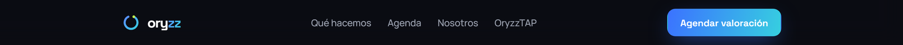
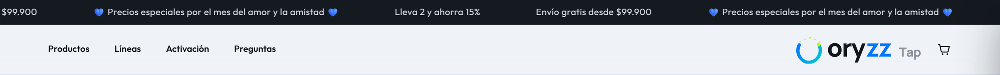

**Evidencia**

- `oryzz/styles.css :root` → Space Grotesk + Manrope · `--blue:#3B72FF` · `--grad:linear-gradient(105deg,#5C8BFF,#36CFE0)` · `--lime:#BFF24A` · fondo `#0B0D12`.
- `/tap` (CSS publicado `_next/static/chunks/*.css`) → `--font-syne`, `--font-outfit` · `--color-brand-blue:#0075ff` · `--color-brand-lime:#c5f500` · `--color-canvas:#eef2f6`.
- Skill `plantilla-documentos-oryzz/scripts/oryzz_brand.py` → Montserrat · `NAVY #0A0E1A` · `TXT_MUTED #666C80` · logo raster `oryzz_mark.png` 727×711.
- Código local `oryzz-tap-store/app/globals.css` → DM Sans + Poppins · `--color-accent:#1a73e8` («escala Google»).
- Cuantificado: 7 familias tipográficas en circulación para 2 funciones; 4 azules primarios; 2 limas; 34 HEX únicos en la home y 91 en Tap.

**Impacto.** El cliente que pasa de un anuncio a oryzz.com, a /tap y a una propuesta en PDF ve tres empresas. La marca no acumula reconocimiento y cada pieza nueva se diseña desde cero.

**Corrección**

- Una sola fuente: `00_Fuente_Maestra/tokens.json` → `11_Web_y_Codigo/tokens/tokens.css`.
- oryzz.com: `<html data-tema="oscuro">`. /tap: `<html data-tema="claro">` (mismo sistema, fondo `#FFFFFF`/`#F6F7F9`).
- Tipografías únicas: Space Grotesk (display) · Manrope (texto) · JetBrains Mono (datos). Retirar Syne, Outfit, Montserrat, DM Sans y Poppins.

### C2 · El CTA principal no se lee: 1,88:1

**Prioridad:** Crítico · **Área:** Accesibilidad

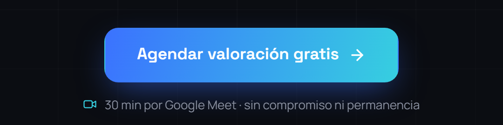

**Evidencia**

- `.btn-grad{background:var(--grad-strong);color:#fff}` con `--grad-strong:linear-gradient(105deg,#3B72FF,#36CFE0)`.
- Blanco sobre #3B72FF = **4,17:1** (suspende AA para 15–17,5 px) · blanco sobre #36CFE0 = **1,88:1**.
- Afecta a los 6 botones `.btn-grad` de la home (cabecera, hero, FAQ, barra móvil, menú móvil, noscript), al de `contacto.html` y al «Aceptar» del banner de cookies en ambas webs.
- /tap: «Elegir el mío» blanco sobre #0075FF = **4,21:1** a 15 px · «−20 %» a 12 px = 4,21:1.
- `box-shadow:0 12px 36px -10px rgba(59,114,255,.6)`: halo azul que reduce aún más la nitidez del borde.

**Impacto.** Es el botón que convierte. Con baja visión, sol en el móvil o pantallas baratas, el final del texto se pierde. Incumple WCAG 2.2 AA (criterio 1.4.3), la referencia de la norma europea EN 301 549.

**Corrección**

- Oscuro: `background:linear-gradient(135deg,#5C8BFF,#36CFE0); color:#0B0D12` → 6,10:1 a 10,33:1. Token `--color-cta-fondo` / `--color-cta-texto`.
- Claro (/tap): `background:#2C5BD0; color:#FFFFFF` → 5,98:1 · hover `#1F43A0` (8,87:1).
- Quitar la sombra de color: `box-shadow:none`.

### C3 · Los logos web no son el logo

**Prioridad:** Crítico · **Área:** Logo

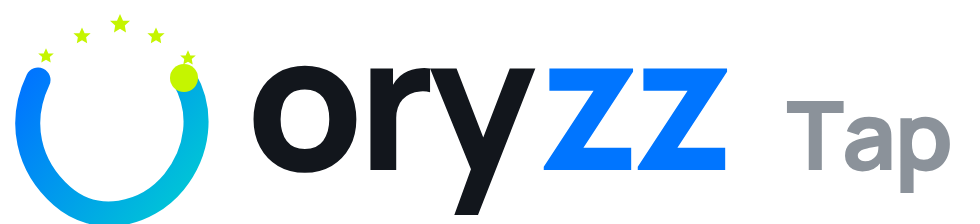

**Evidencia**

- Home: `oryzz` = texto vivo en Space Grotesk 700, 22 px, tracking −0,05 em (el master es −0,038 em con kerning óptico). Si la fuente tarda, se ve en Arial.
- Home: la órbita se redibuja en línea en cabecera y footer con `r="7"`; el favicon usa `r="7.5"`. Tres dibujos distintos del mismo símbolo.
- /tap: `/tap/brand/oryzz-logo-light.svg` = otra órbita (trazada con curvas, degradado #0075FF→#00C6D6) + **5 estrellas lima** + glifos de otra fuente (unidades 2048) + «Tap» con mayúscula.
- Las placas y stands físicos llevan impreso ese lockup antiguo.

**Impacto.** El logo cambia de forma según el soporte y depende de que cargue una fuente. Las estrellas asocian la marca a «reseñas», no a «sistemas que captan clientes».

**Corrección**

- Usar siempre los SVG de `02_Logos/` (wordmark v2 vectorizado).
- Cabecera oryzz.com: `oryzz-logo-horizontal_color-sobre-oscuro.svg`, 26 px de alto. /tap: `oryzz-tap-horizontal_color-sobre-claro.svg`.
- Favicon: `02_Logos/06_Favicon/favicon.svg`; por debajo de 24 px, `isotipo-small`.

### A1 · Grises de texto por debajo de 4,5:1

**Prioridad:** Alto · **Área:** Accesibilidad

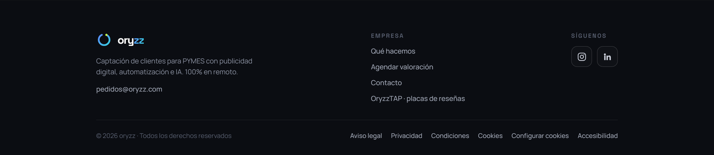

**Evidencia**

- Home `--t5:#5A6172` usado como texto sobre #0B0D12 / #0E1118 = **3,14 / 3,05:1**: «Trabajamos a diario con» (11,5 px), cargos de los socios (12 px), «Empresa» y «Síguenos» (12 px), «© 2026 oryzz» (13 px), `.cal-note` (12,5 px).
- /tap: `#0075FF` sobre `#EEF2F6` = **3,74:1** en «términos y condiciones» (12 px) y «Lleva 2 y ahorra 15 %» (13 px); precio tachado `#6D7680` = **4,10:1** (16 px); «+» de FAQ `#738495` ≈ 3,6:1.

**Impacto.** Justo los textos legales, de precio y de confianza son los que menos se leen.

**Corrección**

- Oscuro: texto terciario = Titanio 400 `#8A90A0` (6,09:1). `#5A6172` solo para bordes o decoración.
- Claro: texto terciario = Grafito 500 `#5A6172` (6,20:1); enlaces = Azul 600 `#2C5BD0` (5,98:1 sobre blanco, 5,57:1 sobre Grafito 50).

### A2 · Casi un tercio del texto por debajo de 14 px

**Prioridad:** Alto · **Área:** Tipografía

**Evidencia**

- oryzz.com: 39 de 124 nodos de texto (31 %) miden 11,5–13,5 px (`.tiny` 13 px, marquesina 11,5 px, figcaption 12 px, `.svc-txt span` 13,5 px, `.eyebrow` 12,5 px).
- /tap: 47 de 166 (28 %) miden 11–13,5 px (`text-[12.5px]`, notas de producto 11–12 px, barra de anuncios 12,5 px).

**Impacto.** En móvil, que es donde entra el tráfico de Meta y TikTok, esos textos obligan a hacer zoom. Mínimo de marca: 14 px.

**Corrección**

- `--text-small:0.875rem` (14 px) como suelo. El eyebrow en JetBrains Mono 12 px es la única excepción y siempre en mayúsculas.

### A3 · Siete formas de escribir el nombre

**Prioridad:** Alto · **Área:** Nombre

**Evidencia**

- «OryzzTAP» en la navegación: 3 veces en `index.html` (nav, menú móvil, footer) y 2 en `contacto.html`.
- «oryzz» en minúscula en texto corrido: `<title>`, `og:site_name`, `"name"` del JSON-LD, `llms.txt`, «© 2026 oryzz».
- «Oryzz Tap» (web de Tap), «oryzz tap» (placas físicas), «Tap» con mayúscula en el lockup, «MyOryzz» (pie de la maqueta de teléfono en /tap), «Oryzz Pro» (línea de producto).

**Impacto.** Los buscadores y los asistentes de IA (GEO, uno de los servicios que vende Oryzz) consolidan peor una entidad con nombres variables.

**Corrección**

- Texto corrido: «Oryzz» y «Oryzz Tap» (dos palabras, T mayúscula). El logo siempre en minúscula y siempre en SVG.
- «MyOryzz» → «Oryzz Tap» (o definir formalmente el nombre de la app si es un producto).
- JSON-LD `"name":"Oryzz"`, `"alternateName":["Oryzz agencia","Oryzz Tap"]`.

### A4 · Iconos con los colores de cada plataforma

**Prioridad:** Alto · **Área:** Iconografía

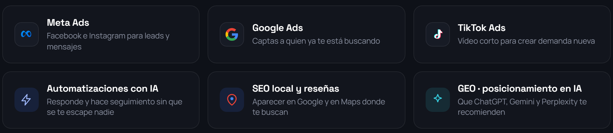
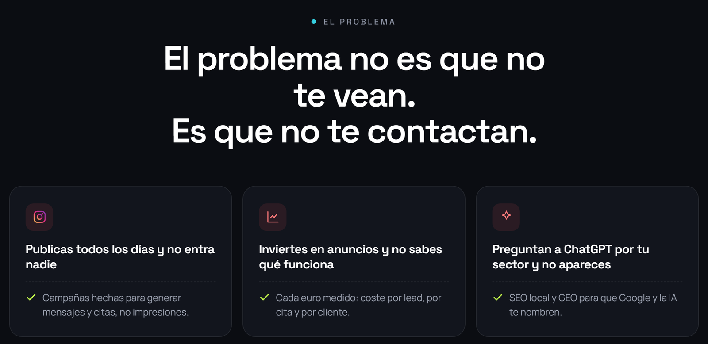

**Evidencia**

- Home: 8 `<symbol>` con colores de terceros: `kgMeta` (#0093F9→#0064E1), `kgGem` (#4285F4→**#9168C0**→#D96570), `kgIg` (#FEC053→**#DD2A7B**→**#8134AF**), Google en 4 colores, WhatsApp #25D366, pin #EA4335 + #4285F4, TikTok #25F4EE/#FE2C55.
- Tarjetas «El problema»: `background:rgba(255,90,90,.1);color:#FF7B7B` → rojo de alarma que no existe en la paleta.
- /tap: 6 iconos a todo color en «Así verá tu negocio» + 6 en la maqueta del teléfono + Instagram y TikTok a color en el footer.

**Impacto.** Rompe la sobriedad grafito + un acento. Introduce violeta y magenta, prohibidos (§8.2). Visualmente, las marcas de Meta y Google pesan más que la de Oryzz.

**Corrección**

- Iconografía propia (`05_Elementos_Graficos/01_Iconos`): retícula 24 px, trazo 1,75 px, `stroke="currentColor"`.
- Logos de plataformas solo monocromos (Grafito 200 en oscuro / Grafito 950 en claro).
- Tarjetas de problema: icono en `--color-texto-3`, sin fondo rojo.

### A5 · El nodo pegado se empasta en una tinta

**Prioridad:** Alto · **Área:** Logo

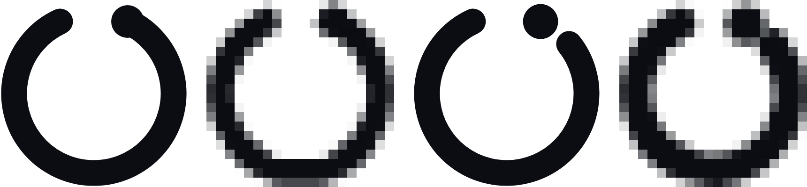

**Evidencia**

- Isotipo actual: nodo `r=7` centrado exactamente en el extremo del arco (64,4 · 19,2) con trazo 11 → se solapan.
- En una tinta (bordado, vinilo, grabado láser, sello) el nodo se convierte en un remate del trazo; a 20 px desaparece (captura: actual a la izquierda, v2 a la derecha).

**Impacto.** El elemento que da significado a la marca (el resultado, el cliente) deja de existir en merchandising, placas grabadas y favicons.

**Corrección**

- Isotipo v2: corte de 2,5 unidades entre nodo y trazo (`oryzz_logo.py`, `ring_path(knockout=True)`). Por debajo de 24 px, versión `isotipo-small` (trazo 14 %).

### A6 · El código de /tap publicado no está en el repositorio

**Prioridad:** Alto · **Área:** Gobernanza

**Evidencia**

- Publicado (oryzz.com/tap): Syne + Outfit, `#0075FF`, `<title>Placas y stands NFC + QR para negocios | Oryzz Tap</title>`.
- Local (`oryzz/oryzz-tap-store/` y la carpeta generada `oryzz/tap/`, 29-07-2026): DM Sans + Poppins, `#1a73e8`, `<title>Oryzz Tap — 2 unidades por $99.900</title>`.

**Impacto.** Cualquier despliegue desde el repositorio local revertiría la tienda a una versión anterior. No se puede migrar con seguridad lo que no está versionado.

**Corrección**

- Localizar el repositorio real de /tap y dejar una única fuente con `tokens.css` + `tailwind-v4.css` antes de tocar nada.

### M1 · Halos difusos, sombras de color y bucles

**Prioridad:** Medio · **Área:** Anti AI-slop

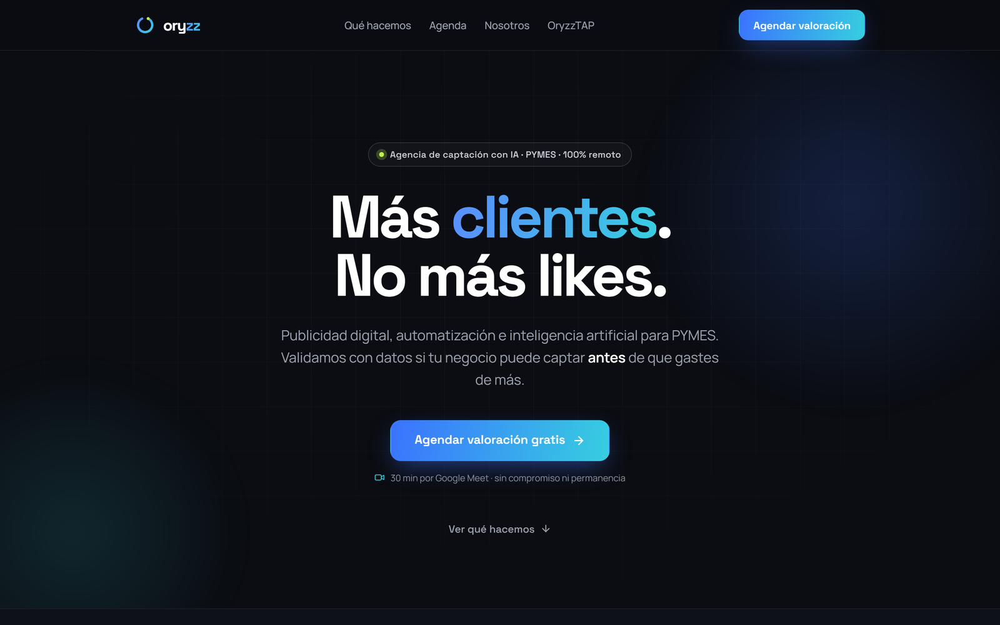

**Evidencia**

- `.aura .a1` 680 px + `.a2` 560 px con `radial-gradient` y `filter:blur(20px)`, animadas con `drift1 22s` y `drift2 27s ... infinite`; repetidas en hero y agenda.
- Bucles permanentes en interfaz: `livePulse 2.4s infinite` (punto del hero), `marquee 42s linear infinite`, `orbSpin 1.5s linear infinite` al pasar por el logo.
- /tap: 3 `radial-gradient` superpuestos en el fondo (#0075ff14, #c5f50012, #ffffffb8) y 9 `blur(8–18px)`.

**Impacto.** Es la firma visual de las landings generadas por IA en 2024–2026. Resta credibilidad a una agencia que vende rigor con datos.

**Corrección**

- Máximo un halo radial ≤ 20 % de opacidad, sin animar. Motion solo en intro, loaders y cierres (órbita 4,4 s). Sustituir por órbitas de 1 px Grafito 700 con un nodo (§5.1).

### M2 · Emojis y tono promocional en la barra de Tap

**Prioridad:** Medio · **Área:** Voz

**Evidencia**

- «💙 Precios especiales por el mes del amor y la amistad 💙» (dos veces en la marquesina) + «Lleva 2 y ahorra 15 %» + «Envío gratis desde $99.900», en bucle.
- Precio tachado «$124.900 → $99.900 · −20 %» permanente; `lib/config.ts` del código local: popup de descuento `TAP10` a los 5 s.

**Impacto.** Emojis y urgencia estacional contradicen la voz («sin humo», §6) y abaratan un producto de 99.900 COP.

**Corrección**

- Un único mensaje fijo, sin emoji: «Envío gratis en Colombia desde $99.900». Promociones solo en campañas con fecha de fin visible.

### M3 · Frases enteras en gradiente y titulares genéricos

**Prioridad:** Medio · **Área:** Tipografía

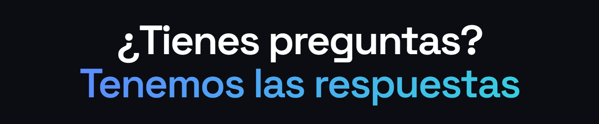

**Evidencia**

- FAQ: «¿Tienes preguntas? **Tenemos las respuestas**» con la segunda línea completa en `.grad`.
- Titular del problema partido en tres líneas con viuda («El problema no es que no / te vean. / Es que no te contactan.»).

**Impacto.** El gradiente pierde valor de firma y el titular de FAQ es un cliché de plantilla.

**Corrección**

- Gradiente solo en una palabra de titulares ≥ 40 px. FAQ: «Preguntas frecuentes». Titular del problema con `max-width:18ch` y salto controlado tras «vean.»

### M4 · Todo centrado, todo en rejillas iguales

**Prioridad:** Medio · **Área:** Composición

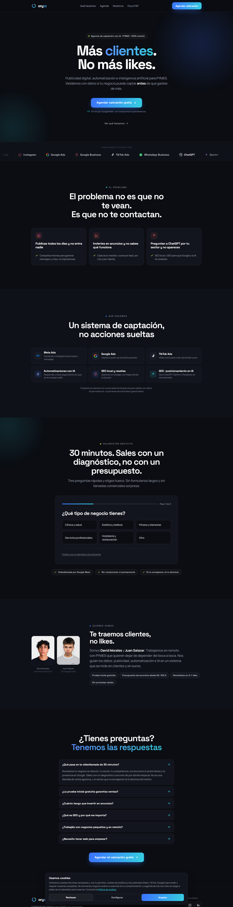

**Evidencia**

- 5 de 7 secciones de la home con cabecera centrada (`.center`); tres tarjetas idénticas en «El problema» y seis chips idénticos en «Qué hacemos».
- Hero con 5 niveles apilados y centrados (pill, H1, lead, botón, nota, enlace).

**Impacto.** Jerarquía plana: nada destaca porque todo pesa igual. Es el patrón de plantilla más reconocible.

**Corrección**

- Retícula 12 col: titulares alineados a la izquierda en 5–7 columnas, contenido desplazado. Servicios como lista con ruta y nodos (§5.2) en lugar de 6 tarjetas.

### M5 · Eyebrow sin la mono de sistema

**Prioridad:** Medio · **Área:** Tipografía

**Evidencia**

- `.eyebrow{font-family:"Space Grotesk";font-size:12.5px;letter-spacing:.22em}`. JetBrains Mono no se carga en ninguna de las dos webs (fuentes cargadas: Manrope 400–600, Space Grotesk 500–700 · Tap: Outfit, Syne).

**Impacto.** Se pierde el registro «sistema / dato» que distingue a Oryzz sin recurrir a iconos de IA.

**Corrección**

- `.ox-eyebrow`: JetBrains Mono 500, 12 px, +0,16 em, mayúsculas. Cargar `JetBrainsMono-Medium.woff2` (39 KB).

### M6 · Promesas y CTA que se contradicen

**Prioridad:** Medio · **Área:** Voz

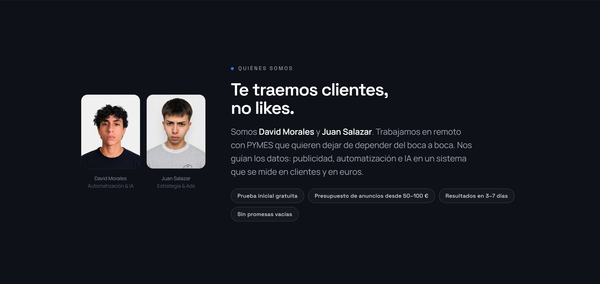

**Evidencia**

- Pill «Resultados en 3–7 días» en «Quiénes somos» frente a «Ni promesas de resultados garantizados» en servicios y la FAQ «¿La prueba garantiza ventas? No».
- Seis textos distintos para el mismo CTA: «Agendar valoración», «Agendar valoración gratis», «Agendar mi valoración gratis», «Agendar valoración gratis · 30 min», «Agendar valoración gratuita de 30 minutos», «Abrir el calendario en Cal.com».

**Impacto.** Resta credibilidad justo donde la marca es más honesta que la competencia.

**Corrección**

- «Primeros datos en 3–7 días». Un CTA único: «Agendar valoración» + nota «30 min · gratis · sin permanencia».

### M7 · og-image, favicon y metadatos con la marca antigua

**Prioridad:** Medio · **Área:** SEO y metadatos

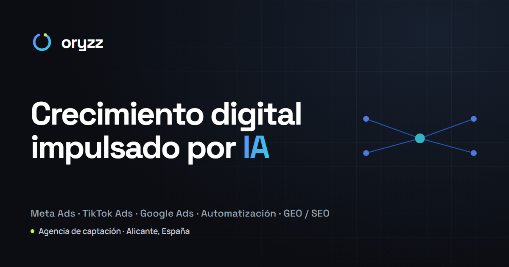

**Evidencia**

- `og-image.png`: wordmark sin gradiente en otra tipografía, isotipo antiguo, claim «Crecimiento digital impulsado por IA» (no es el claim) y gráfico en «X».
- JSON-LD `"logo":"https://oryzz.com/og-image.png"` (1200×630): Google exige logo cuadrado o casi cuadrado.
- /tap: `og:image` 1448×1086 (4:3) → recortes en WhatsApp/LinkedIn; sin `theme-color`; usa el favicon antiguo de la home.
- Ninguna web tiene `apple-touch-icon` ni `manifest`.

**Impacto.** Cada enlace compartido por WhatsApp, LinkedIn o Google muestra la marca antigua.

**Corrección**

- og-image 1200×630 nueva por web (`09_Redes_Sociales`). `"logo"` → PNG 512×512 del isotipo. `apple-touch-icon` 180 px desde `05_Avatar_Perfil`. /tap: `<meta name="theme-color" content="#FFFFFF">`.

### M8 · Correo gmail como contacto de marca

**Prioridad:** Medio · **Área:** Confianza

**Evidencia**

- `oryzz.management@gmail.com` aparece 16 veces (4 index, 2 contacto, 10 legal) + `llms.txt` + JSON-LD, mientras existe el dominio (`pedidos@oryzz.com`). JSON-LD con teléfono +57 para un negocio con sede fiscal en Alicante.

**Impacto.** Un correo gratuito en una agencia que cobra por profesionalizar la captación de otros transmite provisionalidad.

**Corrección**

- `{{hola@oryzz.com}}` en web, schema y llms.txt; revisar el teléfono publicado.

### M9 · Banner de cookies oscuro dentro de la tienda clara

**Prioridad:** Medio · **Área:** Sistema

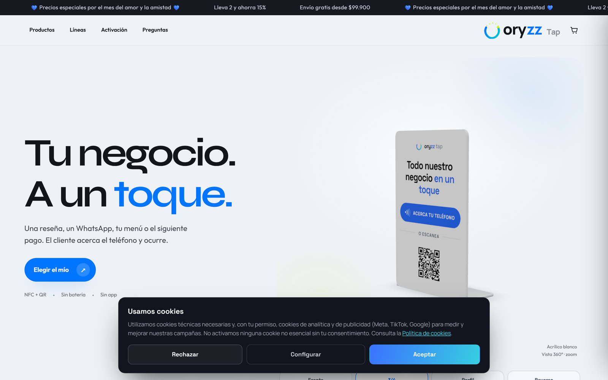

**Evidencia**

- `cookies.js` compartido: en /tap aparece el panel grafito de la home con «Aceptar» en gradiente con texto blanco (1,88:1) sobre la página `#EEF2F6`.

**Impacto.** El primer elemento que ve el visitante de Tap pertenece a otra web.

**Corrección**

- Estilar el banner con variables semánticas (`--color-superficie`, `--color-cta-*`) para que herede `data-tema`.

### M10 · Placas y stands impresos con el lockup antiguo

**Prioridad:** Medio · **Área:** Producto

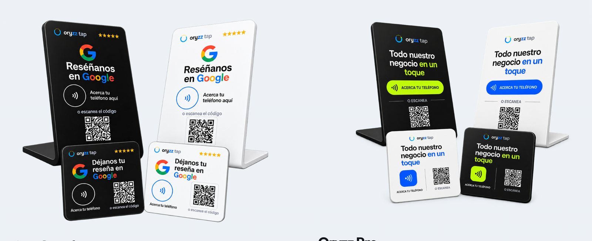

**Evidencia**

- Todas las renders de producto (Reseñas Google y Oryzz Pro, blanco y negro) llevan «oryzz tap» antiguo, con el nodo pegado; las Pro alternan lima #C5F500 y azul #0075FF como color de botón.

**Impacto.** El producto físico es la pieza de marca que más tiempo vive en el mundo real (mostradores, 2–3 años).

**Corrección**

- Nuevas artes con `oryzz-tap-horizontal_solido-*` (sin gradiente, una tinta). Reimprimir al agotar stock; no destruir inventario.

### B1 · Fuentes duplicadas

**Prioridad:** Bajo · **Área:** Rendimiento

**Evidencia**

- `oryzz/fonts/`: 16 WOFF2 que son solo 4 archivos distintos (cada peso 400/500/600/700 es copia del mismo archivo variable). El navegador puede descargar el mismo archivo hasta 4 veces por familia (~240 KB redundantes).

**Impacto.** Peso extra en la primera visita móvil.

**Corrección**

- `11_Web_y_Codigo/fonts/fonts.css`: un WOFF2 por peso (29–39 KB) o un variable por familia.

### B2 · 88 estilos en línea

**Prioridad:** Bajo · **Área:** Código

**Evidencia**

- `index.html` contiene 88 atributos `style=""` con colores (`#fff`, `#0B0D12`) y tamaños (12, 13, 14, 15 px) fijados a mano.

**Impacto.** Ningún cambio de tema o de token llega a esos elementos.

**Corrección**

- Sustituir por clases de `oryzz-ui.css` (`.ox-small`, `.ox-eyebrow`, `.ox-btn--sm`…).

### B3 · Dos gradientes y ángulo distinto

**Prioridad:** Bajo · **Área:** Color

**Evidencia**

- `--grad` (#5C8BFF→#36CFE0) y `--grad-strong` (#3B72FF→#36CFE0), ambos a 105°. El logo y la guía usan 135°.

**Impacto.** Pequeñas diferencias de color entre logo, titulares y botones.

**Corrección**

- `--grad-ia-oscuro` / `--grad-ia-claro`, siempre 135°.

### B4 · Plantilla de documentos con otra marca

**Prioridad:** Bajo · **Área:** Documentos

**Evidencia**

- Skill `plantilla-documentos-oryzz`: portada navy `#0A0E1A`, Montserrat, logo PNG 727×711, lima `#BFF24A` usado como color de viñeta sobre fondo claro (1,31:1).

**Impacto.** Propuestas e informes —lo que lee quien paga— no se parecen a la web.

**Corrección**

- Sustituir por las plantillas de `07_Documentos` (Space Grotesk + Manrope, logo SVG). Retirar la skill antigua.

### B5 · Valoración fija en el código

**Prioridad:** Bajo · **Área:** Confianza

**Evidencia**

- `lib/config.ts`: `RATING_AVERAGE = "4,9"`, `RATING_COUNT = 247` codificados a mano.

**Impacto.** Si se muestra sin fuente verificable, es una cifra inventada (§8.7) y un riesgo legal de consumo.

**Corrección**

- Mostrar solo con enlace a la fuente (perfil de Google) o retirar.

## 4. Plan de migración por fases

### Fase 0 · Gobernanza (Semana 0–1)

- Localizar el repositorio real de /tap y versionarlo.
- Nombrar responsable de marca y aprobar `tokens.json` v2 como única fuente.
- Decidir correo de dominio (`hola@oryzz.com`).

### Fase 1 · Correcciones críticas (Semana 1)

- CTA: texto Grafito 950 sobre gradiente (oscuro) · Azul 600 + blanco (claro).
- Grises: `#5A6172` fuera de todo texto sobre oscuro.
- «OryzzTAP» → «Oryzz Tap». Logos y favicon → SVG v2.
- Tap: quitar emojis y marquesina.

### Fase 2 · Migración del sistema (Semanas 2–3)

- `tokens.css` + `fonts/` en ambas webs; Tap a Space Grotesk + Manrope.
- 91 HEX de Tap → tokens; `bg-canvas` → Grafito 50.
- Iconografía monocroma; fuera halos, glow y bucles.
- Texto mínimo 14 px; eyebrow en JetBrains Mono.

### Fase 3 · Contenido y metadatos (Semanas 3–4)

- og-images nuevas, logo cuadrado en JSON-LD, `apple-touch-icon`, `theme-color`.
- CTA único, «Primeros datos en 3–7 días».
- Composición asimétrica en hero, servicios y FAQ.

### Fase 4 · Fuera de la web (Semanas 4–6)

- Documentos: plantillas de `07_Documentos`; retirar skill navy/Montserrat.
- Redes: avatares `02_Logos/05`, plantillas `09_Redes_Sociales`.
- Email: firmas y plantillas de `08_Email` con logo sólido PNG.
- Producto físico: artes nuevas, reimpresión al agotar stock.

| Fase | oryzz.com | oryzz.com/tap | Documentos | Redes | Email |
|---|---|---|---|---|---|
| Fase 0 | Congelar cambios de diseño | Recuperar repo real · un solo origen | Inventario de plantillas en uso | Inventario de perfiles y avatares | Decidir hola@oryzz.com |
| Fase 1 | CTA, grises, nombre, logo SVG, favicon | CTA Azul 600, logo tap v2, sin emojis | — | Avatar v2 en @oryzzai y @oryzztap | Firma con logo sólido PNG |
| Fase 2 | tokens.css, fuentes, iconos, sin aura | tailwind-v4.css, Space Grotesk/Manrope, 91 HEX → tokens | Plantillas 07 en PDF/Docs | Plantillas 09 para posts y stories | Plantilla transaccional (pedidos Tap) |
| Fase 3 | og-image, JSON-LD, composición, CTA único | og-image 1200×630, theme-color, cookies claro | Propuesta + informe con datos «Ejemplo» | Portadas destacadas y banner LinkedIn | Newsletter / secuencia de bienvenida |
| Fase 4 | Revisión WCAG completa | Artes de placas y stands v2 | Retirar skill antigua | Auditoría de la parrilla | Revisión de dominios y DMARC |

## 5. Checklist de migración

### Gobernanza

- [ ] Repositorio real de /tap localizado y versionado
- [ ] `tokens.json` v2 aprobado como fuente única
- [ ] Responsable de marca nombrado

### oryzz.com

- [ ] `tokens.css` enlazado antes de `styles.css`; `data-tema="oscuro"`
- [ ] Botones: gradiente 135° + texto `#0B0D12`, sin `box-shadow`
- [ ] `--t5` fuera de cualquier texto (usar `--color-texto-3`)
- [ ] Logo de cabecera y footer = SVG horizontal v2 (no texto vivo)
- [ ] `favicon.svg` v2 + `apple-touch-icon` 180 px
- [ ] «OryzzTAP» → «Oryzz Tap» (5 apariciones)
- [ ] Iconos monocromos; fuera `kgMeta`, `kgGem`, `kgIg` y el rojo `#FF7B7B`
- [ ] `.aura`, `livePulse`, `orbSpin` en hover y glow eliminados
- [ ] Texto ≥ 14 px (salvo eyebrow mono 12 px)
- [ ] Eyebrow en JetBrains Mono
- [ ] og-image nueva y `"logo"` cuadrado en JSON-LD
- [ ] CTA único «Agendar valoración»; «Primeros datos en 3–7 días»
- [ ] `fonts/` sustituida (sin duplicados)

### oryzz.com/tap

- [ ] `tailwind-v4.css` + `tokens.css`; `data-tema="claro"`
- [ ] Syne y Outfit retiradas; Space Grotesk + Manrope
- [ ] CTA `#2C5BD0` + blanco; enlaces `#2C5BD0`
- [ ] Logo `oryzz-tap-horizontal_color-sobre-claro.svg` (sin estrellas)
- [ ] Barra de anuncios sin emojis, sin marquesina
- [ ] Banner de cookies en tema claro
- [ ] `theme-color #FFFFFF`, og-image 1200×630
- [ ] «MyOryzz» revisado

### Documentos, redes y email

- [ ] Plantillas de `07_Documentos` en uso; skill navy/Montserrat retirada
- [ ] Avatares v2 en Instagram, TikTok y LinkedIn
- [ ] Firmas de email con logo sólido PNG y correo de dominio
- [ ] Artes de placas y stands v2 listas para la próxima tirada

### Verificación

- [ ] Contraste AA de todos los textos (herramienta: matriz de `03_Color`)
- [ ] Prueba en móvil real con sol / brillo bajo
- [ ] Captura antes / después archivada en `12_Auditoria_y_Mejoras`

## Método

- Capturas y estilos computados de https://oryzz.com/ y https://oryzz.com/tap/ con Chrome headless (`00_Fuente_Maestra/build/web_capture.py`), 1440×900 y 390×844.
- Contraste WCAG 2.2 (luminancia relativa) calculado para cada nodo de texto visible; en gradientes se toma el punto más débil.
- Revisión del código local `TAP/OryzzTAP/oryzz/` (solo lectura) y de la skill `plantilla-documentos-oryzz`.
